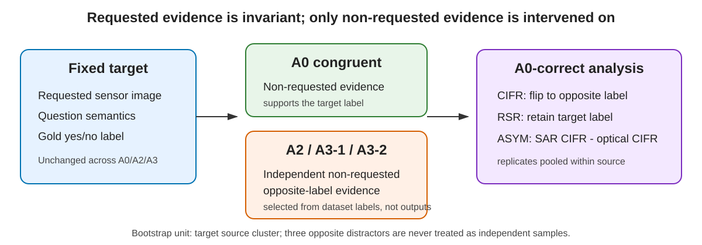

# Auditing Sensor Faithfulness in Remote-Sensing Visual Question Answering via Counterfactual Optical–SAR Conflicts

This repository contains the code, fixed metadata-only fixtures, configuration
files, and paper-artifact generators for a diagnostic study of whether
remote-sensing VQA models follow the explicitly requested sensor when optical
and SAR evidence conflict. It is an evaluation repository, not a hallucination
mitigation method.



## Core findings

- Counterfactual susceptibility was observed across the two evaluated datasets
  and three evaluated models.
- Directional interference was heterogeneous across models. The external
  BigEarthNet interface was pre-specified as optical-first/SAR-second.
- Sensor competence does not by itself establish evidence faithfulness.

These findings do **not** establish universal optical dominance, universal SAR
weakness, causal sensor dominance, or state-of-the-art mitigation.

## Installation

For the CPU-only demo and paper artifacts:

```bash
conda env create -f environment.yml
conda activate sensor-faithfulness-rsvqa
pip install -e .
```

The historical GPU manifests recorded Python 3.10, PyTorch 2.3.1, and
Transformers 4.49.0. Model-specific upstream packages may also be required by
EarthMind custom code; see [docs/REPRODUCIBILITY.md](docs/REPRODUCIBILITY.md).

## Data preparation

Raw images are not included. Obtain data from the official sources, accept their
licenses, and place only allowed non-test assets under `${DATA_ROOT}`.

- M4-SAR: `wchao0601/m4-sar`, revision
  `e1609a2c7d2cacda10d4ad1e895df9627f37c236`.
- BigEarthNet.txt annotations: `BIFOLD-BigEarthNetv2-0/BigEarthNet.txt`,
  revision `72d865f2146f0a85b720f7f3ca1cdbaeafc3d316`.
- BigEarthNet v2 images: DOI `10.5281/zenodo.10891137`, version 2.0.0.

The repository never requires or authorizes access to the M4-SAR official test
split. See [docs/DATASETS.md](docs/DATASETS.md) for expected relative paths and
license boundaries.

## Model preparation

Download checkpoints from their official repositories into `${MODEL_ROOT}` and
pin the revisions in [configs/models.yaml](configs/models.yaml):

- Qwen2.5-VL-3B-Instruct: `66285546d2b821cf421d4f5eb2576359d3770cd3`
- EarthMind-4B: `f17c66b01e540268f3862a540e84a3f7ee329cd3`
- LLaVA-OneVision-7B: `0d50680527681998e456c7b78950205bedd8a068`

Qwen and LLaVA-OneVision are general VLM controls. EarthMind is described here
conservatively as a multi-sensor EO model. Checkpoints retain their upstream
licenses and are not redistributed.

## Quick start: no GPU and no large model

```bash
python scripts/compute_cifr_rsr.py \
  --predictions examples/small_demo/predictions.csv \
  --fixture examples/small_demo/fixture.csv
```

Expected key output:

```text
CIFR = 0.8888888889
RSR  = 0.1111111111
ASYM = 0.3333333333
```

This synthetic demo checks the metric implementation only. It is not a paper
result.

## Verify the fixed fixtures

```bash
python scripts/verify_fixture.py \
  fixtures/m4sar/COUNTERFACTUAL_CONFIRMATORY_FIXTURE.jsonl \
  --expected-sha256 94b71c918476a266a901ee7d3430f16d3c104369c6ce29c1cce1a4e50555baef

python scripts/verify_fixture.py \
  fixtures/bigearthnet/BIGEARTHNET_EXTERNAL_FULL_FIXTURE.jsonl \
  --expected-sha256 262ebdcc3b09da82ed4508cae7edce9235857b864acd81b2130078be51fda6cb
```

Both commands must report zero duplicate fixture IDs, source overlap, label
violations, missing requested evidence, and prohibited test references.

## Reproduce M4-SAR

The confirmatory fixture contains 420 source clusters and 3,360 rows. It uses
requested-evidence-first ordering and the conditions `A0_CONGRUENT`,
`A2_CONFLICT`, `A3_CONFLICT_REPLICATE_1`, and
`A3_CONFLICT_REPLICATE_2`. The 200 pilot sources are listed separately and are
not part of the confirmatory fixture.

```bash
python scripts/run_inference.py \
  --backend qwen \
  --model ${MODEL_ROOT}/Qwen2.5-VL-3B-Instruct \
  --revision 66285546d2b821cf421d4f5eb2576359d3770cd3 \
  --fixture fixtures/m4sar/COUNTERFACTUAL_CONFIRMATORY_FIXTURE.jsonl \
  --expected-fixture-sha256 94b71c918476a266a901ee7d3430f16d3c104369c6ce29c1cce1a4e50555baef \
  --data-root ${DATA_ROOT} \
  --output outputs/raw/m4sar_qwen.jsonl \
  --manifest outputs/m4sar_qwen_manifest.json
```

Use `--backend earthmind` or `--backend llava_onevision` with the pinned model
and revision. The wrapper retains failed rows and never changes the parser.

## Reproduce BigEarthNet

The full fixture contains 341 sources; the primary external summary excludes
the 20 pre-exposed smoke sources listed in
`metadata/BIGEARTHNET_SMOKE_EXCLUDED_SOURCES.csv`, leaving 321 sources. The
interface is optical-first/SAR-second for both requested directions. Frozen
rendering is defined in [configs/bigearthnet_rendering.json](configs/bigearthnet_rendering.json).

Use the same `scripts/run_inference.py` command with the BigEarthNet fixture and
its hash. Do not alter the rendering, prompt, image order, distractor mapping,
or parser for any model.

## Metrics

- **CIFR:** among A0-correct source/direction pairs, the mean indicator that an
  opposite condition answers with the opposite distractor label.
- **RSR:** among the same pairs, the mean indicator that the target answer is
  retained under conflict.
- **ASYM:** paired source-level SAR-requested CIFR minus optical-requested CIFR.
- **Robust flip:** an A0-correct target flips for at least two of three
  independent opposite distractors.

Replicates are averaged within a source/direction. Bootstrap resampling is over
target source clusters. Exact definitions are in [docs/METRICS.md](docs/METRICS.md).

## Reproduce paper tables

```bash
python scripts/reproduce_table3.py
python scripts/check_paper_consistency.py
```

The first command rebuilds `results/paper_summary/table3_reproduced.tex`. The
second verifies the frozen fixture, rendering, robust-flip, and six-row summary
hashes.

## Reproduce paper figures

```bash
python scripts/reproduce_figure2.py
python scripts/reproduce_figure3.py
```

Outputs are written to `figures/` as PDF and PNG. Plotting reads the frozen
summary; it does not recompute or modify results.

## Tests

```bash
PYTHONPATH=src python -m unittest discover -s tests -p "test_core.py" -v
```

On PowerShell, use `$env:PYTHONPATH='src'` before the Python command.

## Citation

The final author order has not yet been provided. `CITATION.cff` therefore
contains an explicit TODO and must be completed before public release. No paper
DOI, journal, volume, issue, pages, or publication status is asserted here.

## License

Repository-authored code is prepared under the Apache License 2.0 candidate in
`LICENSE`. Third-party datasets and model checkpoints retain their original
licenses and are not redistributed by this repository. See
[OPEN_SOURCE_LICENSE_AUDIT.md](OPEN_SOURCE_LICENSE_AUDIT.md) and
[THIRD_PARTY_NOTICES.md](THIRD_PARTY_NOTICES.md).
